# CART 253: Creative Computation

this will be my CART 253 project showcase website!Hope you like it!!!! (Odyssy is not my favorite movie. It's just the first thing that came to mind having watched it so recently.)

## Useful Links

- [Reflective Journal](journal.md)
- [My GitHub profile](https://github.com/Sishooboy)

## Prototyping: Instructions

### Robot

- [Run the prototype](https://sishooboy.github.io/CART-253-/instructions-prototypes/robot/)
- [View the code](instructions-prototypes/robot/sketch.js)

### Moses and the Sea

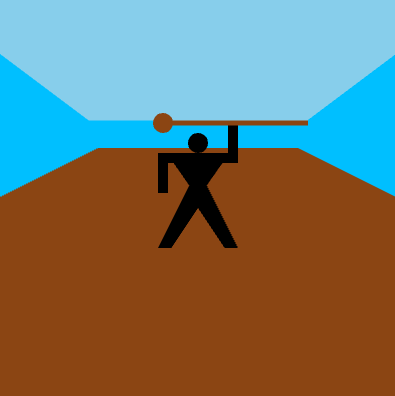

- [Run the prototype](https://sishooboy.github.io/CART-253-/instructions-prototypes/moses-sea/)
- [View the code](instructions-prototypes/moses-sea/sketch.js)

### Abstract Squares

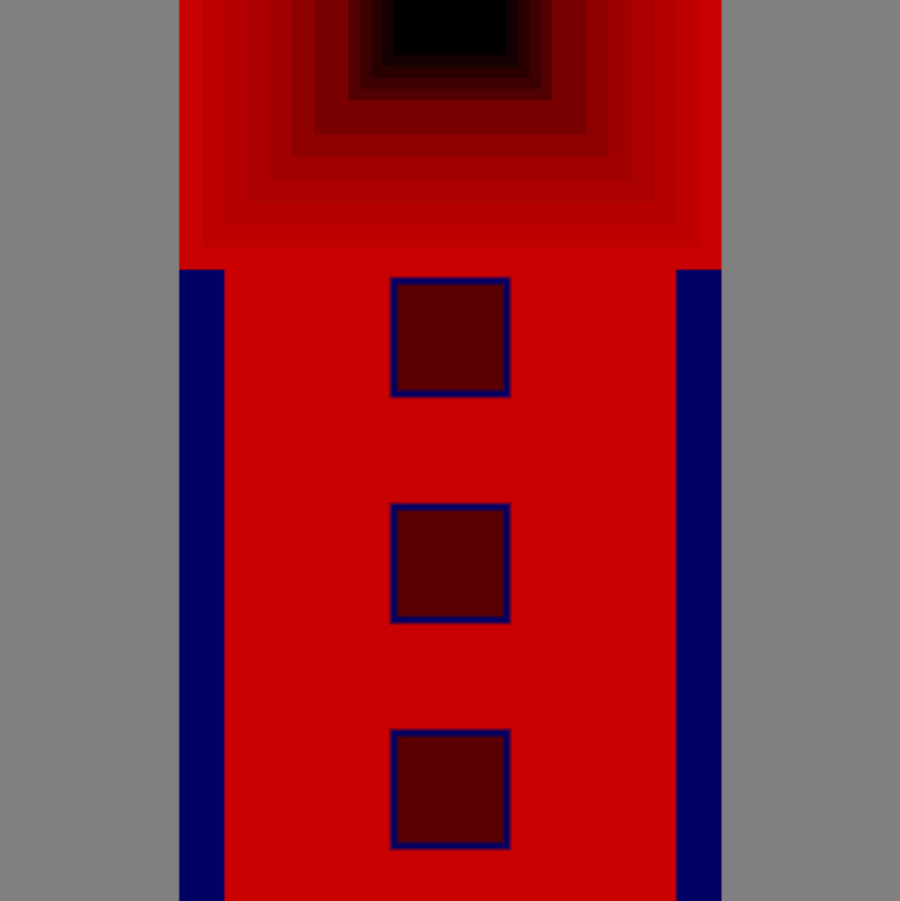

- [Run the prototype](https://sishooboy.github.io/CART-253-/instructions-prototypes/abstractsquares/)
- [View the code](instructions-prototypes/abstractsquares/sketch.js)

## Prototyping: Variables

### The Bird Fam

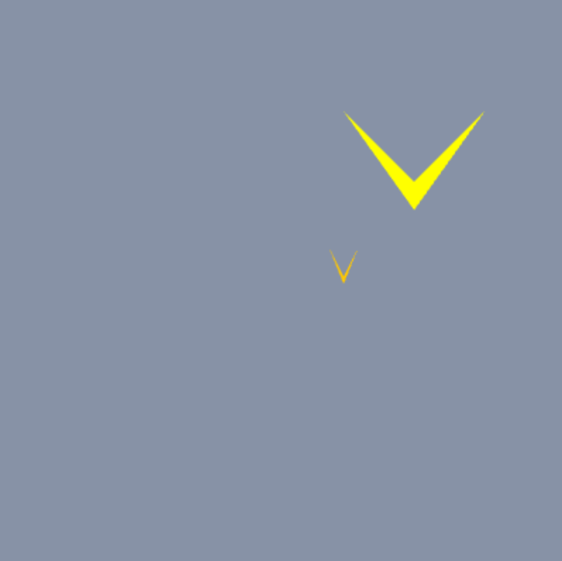

- [Run the prototype](https://sishooboy.github.io/CART-253-/VARIABLEPROT/prototype-1-/)
- [View the code](VARIABLEPROT/prototype-1-/js/script.js)

### The Bird but He Is Actually a Bird

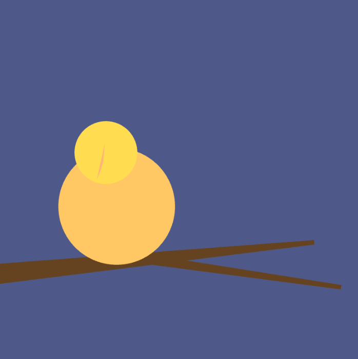

- [Run the prototype](https://sishooboy.github.io/CART-253-/VARIABLEPROT/prototype-2-/)
- [View the code](VARIABLEPROT/prototype-2-/js/script.js)

### Phoenix

- [Run the prototype](https://sishooboy.github.io/CART-253-/VARIABLEPROT/prototype-3-/)
- [View the code](VARIABLEPROT/prototype-3-/js/script.js)

## Prototyping: Conditionals

### The Bird Hunter

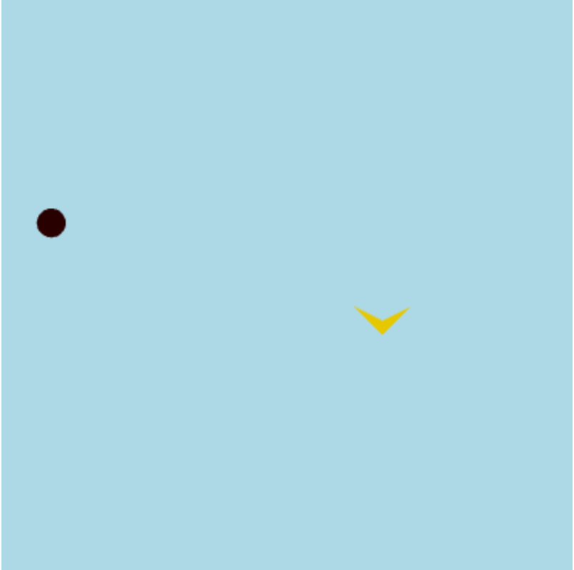

- [Run the prototype](https://sishooboy.github.io/CART-253-/conditional-protptypes/prototype-1-/)
- [View the code](conditional-protptypes/prototype-1-/js/script.js)

### Pokemon Evolution

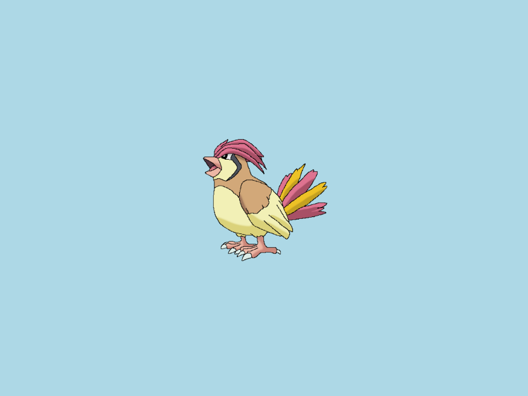

- [Run the prototype](https://sishooboy.github.io/CART-253-/conditional-protptypes/prototype-2-/)
- [View the code](conditional-protptypes/prototype-2-/js/script.js)

### The Brave Phoenix

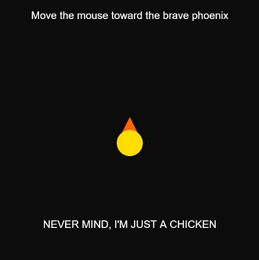

- [Run the prototype](https://sishooboy.github.io/CART-253-/conditional-protptypes/prototype-3-/)
- [View the code](conditional-protptypes/prototype-3-/js/script.js)

[Read my journal entry for this assignment](journal.md#conditionals-assignment)

## Prototyping: Events

### Hungry Bird

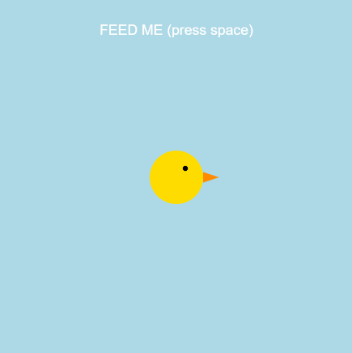

- [Run the prototype](https://sishooboy.github.io/CART-253-/eventprot/prototype-1-/)
- [View the code](eventprot/prototype-1-/js/script.js)

### Sleepy Bird

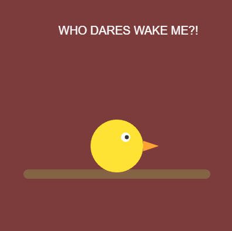

- [Run the prototype](https://sishooboy.github.io/CART-253-/eventprot/prototype-2-/)
- [View the code](eventprot/prototype-2-/js/script.js)

### Pick Up the Bird

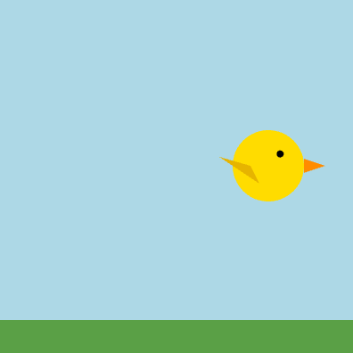

- [Run the prototype](https://sishooboy.github.io/CART-253-/eventprot/prototype-3-/)
- [View the code](eventprot/prototype-3-/js/script.js)

[Read my journal entry for this assignment](journal.md#events-assignment)

## Prototyping: Functions

### Owl Family

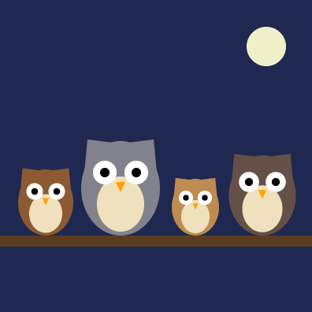

- [Run the prototype](https://sishooboy.github.io/CART-253-/functionsprot/prototype-1-/)
- [View the code](functionsprot/prototype-1-/js/script.js)

### Colored Penguin Colony

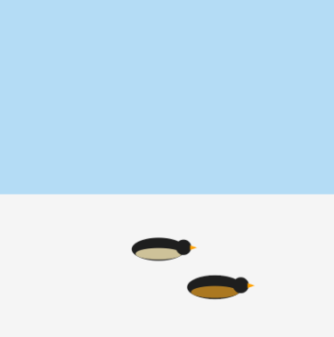

- [Run the prototype](https://sishooboy.github.io/CART-253-/functionsprot/prototype-2-/)
- [View the code](functionsprot/prototype-2-/js/script.js)

### Pigeon Problem

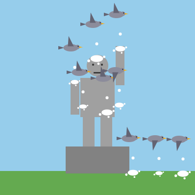

- [Run the prototype](https://sishooboy.github.io/CART-253-/functionsprot/prototype-3-/)
- [View the code](functionsprot/prototype-3-/js/script.js)

[Read my journal entry for this assignment](journal.md#functions-assignment)

## Prototyping: Arrays

### Bird Dating

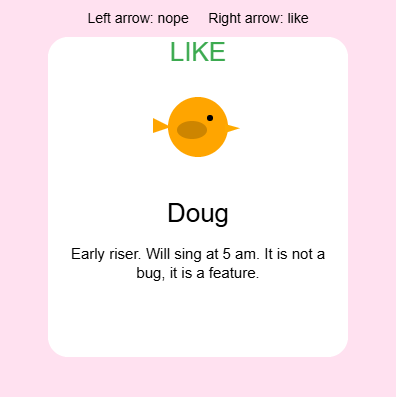

- [Run the prototype](https://sishooboy.github.io/CART-253-/arraysprot/prototype-1-/)
- [View the code](arraysprot/prototype-1-/js/script.js)

### Parrot Talk

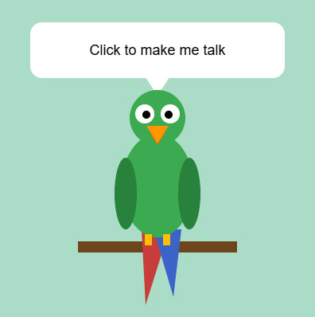

- [Run the prototype](https://sishooboy.github.io/CART-253-/arraysprot/prototype-2-/)
- [View the code](arraysprot/prototype-2-/js/script.js)

### Bird Slots

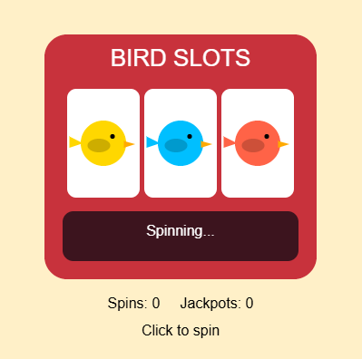

- [Run the prototype](https://sishooboy.github.io/CART-253-/arraysprot/prototype-3-/)
- [View the code](arraysprot/prototype-3-/js/script.js)

[Read my journal entry for this assignment](journal.md#arrays-assignment)
