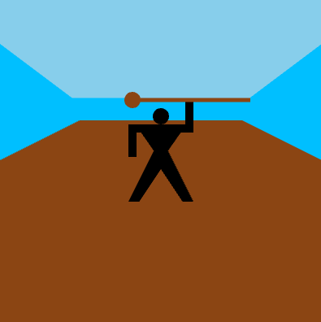
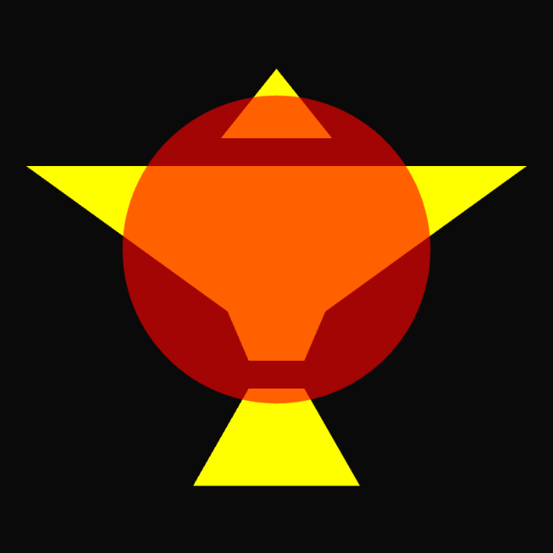
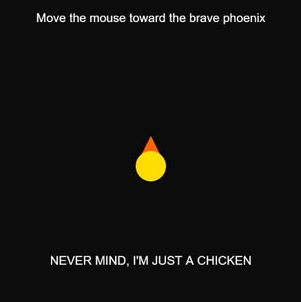
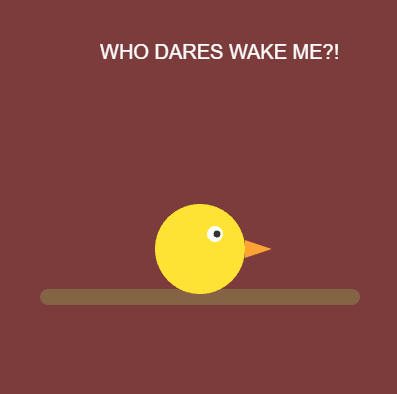
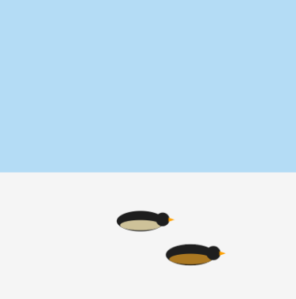
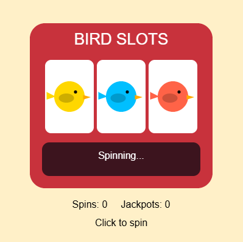

# Reflective Journal

## September 16, 2026

I am already somewhat familiar with markdown so this wasn't that hard of a task to do. Although generally I'm excited for this course for being able to create my own websites and expressing myself through machines is definitely something I'm looking forward to doing.

## instructions-assignment

To be honest I did not expect having this much fun with this. Took a little buit to get used to it in the first robot prototype but as soon as I finished I knew I wanted to make something animated. First thing I thought of is like something splitting, also that's the last thing I thought of. I decided to split the sea with Moses and I knew working with animateion could be hard and it was before I got the hang of it. Here I used Ai as my teacher, to help explain the errors that were happening and explaining the dimensions and how WEBGL works. Eventually I got the waves splitting and so I added details with the body of moses the staff the remaining sea that can be seen at the end where everything vanishes and it turned out awesome. For the last one I guess I was just aiming to do something abstract, particularly with squares,and more specifically red squares(I like red) until I started seeing visions of what it could be and so I tried my best completing these visions I guess.

At the end I think it safe to say that these designs look good, funny ones may call them, but nonetheless solid, I had a blast doing these and figuring out how to solve problems, how to position things and just creatively just going with the flow of persistent new ideas while working although that was a little tricky to deal with. 

## variables assignment

I enjoyed this assignment, it was very fun, althou I don't think it was as fun as the last one, but I enjoyed the whole theme of imagining just birds in different. First making 2 birds a mother bird and her baby bird awkwardly following her, it was challenging to find the solution to how I was going to make the whole bird move with sinus and them make his wings flap with sinus also just on a way smaller scale, and I thought I was very clever finding the solution to this by adding the y-coordinates together which now sounds very basic and stupid but it had to be very well thought of. The second one's hardest challenge was the beak and matching it to the head. But basically I just limited the time in which the beak coordinates moved to the time the head moved, so basically when the head stopped moving so did the beak, and I just matched the speed of each coordinates movement to be able to get the best result possible. The last one is my favorite although it is the most basic, just a phoenix pulsating aura. The aura's growth speed is decreasing, and also matched the decreasing growth speed to the opacity to give a nicer effect and yeah that's all.

## conditionals assignment

I had a lot of fun with this assignment because conditionals made everything feel way more interactive. For the first one I made the cursor into a bird hunting a little prey and when it catches it the prey gets sent back, which was simple but still pretty funny to play with. The second one was probably the hardest because I wanted the Pokemon to go through all 3 evolutions every time you click. I had some trouble getting the images to load and understanding how to switch between them, but once it worked it ended up being very simple. For the last one I made a brave phoenix that acts all powerful until you move the mouse close to him, then he shrinks and admits that he is just a chicken. That one is probably my favorite just because of how stupid the joke is.

Overall I think I understand conditionals much better now, especially how they can check distance, mouse clicks and the value of variables to make different things happen. These prototypes are all pretty basic but they each do something different and I think they turned out funny.

## events assignment

I'm handing this one in late because I started it late, so I did it in the p5 editor, prepared the code there and then pasted it into my repository. I used the same bird model for all three prototypes so I could focus on the events instead of redrawing a bird every time. The first one is a hungry bird that you feed with the space bar, he gets bigger until he is too fat to fly and sinks, and if you stop he shrinks back. The second is a sleepy bird, moving the mouse makes him grumpy, a click makes him furious and turns the sky red, but if you leave him alone the sky turns into morning and he wakes up happy. The last one you can pick up and drag, he flaps in a panic, falls when you let go, gets tickled by the scroll wheel and squawks if you double click him.

I didn't like working with millis() because you have to save a time and subtract it from the current time every frame, which was hard to picture and easy to get wrong. I still used it for the hungry bird but for the others I used a counter that goes down every frame, which is way easier to read. What I learned is that events only change variables and then the same if statements from last week decide what happens. I hope people feel a little guilty for dropping the bird, or proud for being patient with the sleepy one.

## functions assignment

I liked this assignment because functions made it so much easier to fill the screen with stuff. For the first one I made a family of owls, I drew one owl and then turned it into a function with parameters for the position, the size and the colour, so I could call it four times and get a family on a branch under the moon. The second one was my favorite, penguins that slide on their bellies, shoot in fast and slow down before they leave the screen. This one has a function that returns a new penguin with a random size, speed and belly colour, which took me the longest to understand because you have to store what it gives back in a variable. Clicking makes a whole new colony.

The last one I really didn't like how it turned out compared to what I had in mind. I had something way more alive in mind and I wasn't sure I could make it come to life, so I ended up with a statue that you click to make a pigeon drop splats on it, but the pigeons don't move and you can have flying splat lol. It's funny for like a minute but it's not what I pictured. The functions do get called again on every click though, so I guess it still shows the idea.

Overall I think I understand functions much better now, especially parameters and how one function can be used again and again instead of copying the same code. I want to come back to the idea I had for the last one having a pigeon come in drop its splat and fly away.

## arrays assignment

This week was about arrays so I kept doing birds. The first one is a dating app for birds, each bird has a name, a colour, a size and a bio, so I made four arrays that go together. You swipe with the arrow keys and at the end it tells you who you matched with, which is an empty array that grows every time you like a bird. The second one is a parrot that tells a story about it being coming across a non expected thing in Montreal while searching for cornflakes. Each click he says the next line from his array and his beak moves while he talks. The last one is a slot machine with birds, you click, the windows stop one after the other and three of the same bird is a jackpot.

I had to change my ideas a few times because they were too complicated. The slot machine took the longest because I wanted the birds to show up one by one and not all at once. A jackpot is pretty rare with only 5 colours, which makes it feel good when it happens. What I learned is that an array is just a list where every item has a number, and random() can pick from it. Another thing I like is that if I add a new bird to the list, the rest of the code still works without changing anything. My favorite part is the losing messages because the machine is very rude to you.

