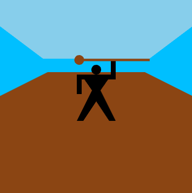
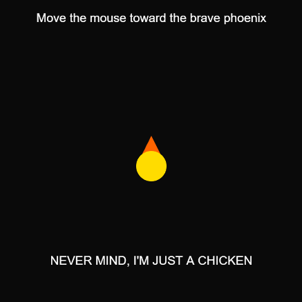

# Reflective Journal

## September 16, 2026

I am already somewhat familiar with markdown so this wasn't that hard of a task to do. Although generally I'm excited for this course for being able to create my own websites and expressing myself through machines is definitely something I'm looking forward to doing.

## instructions-assignment

To be honest I did not expect having this much fun with this. Took a little buit to get used to it in the first robot prototype but as soon as I finished I knew I wanted to make something animated. First thing I thought of is like something splitting, also that's the last thing I thought of. I decided to split the sea with Moses and I knew working with animateion could be hard and it was before I got the hang of it. Here I used Ai as my teacher, to help explain the errors that were happening and explaining the dimensions and how WEBGL works. Eventually I got the waves splitting and so I added details with the body of moses the staff the remaining sea that can be seen at the end where everything vanishes and it turned out awesome. For the last one I guess I was just aiming to do something abstract, particularly with squares,and more specifically red squares(I like red) until I started seeing visions of what it could be and so I tried my best completing these visions I guess.

At the end I think it safe to say that these designs look good, funny ones may call them, but nonetheless solid, I had a blast doing these and figuring out how to solve problems, how to position things and just creatively just going with the flow of persistent new ideas while working although that was a little tricky to deal with. 

## variables assignment

I enjoyed this assignment, it was very fun, althou I don't think it was as fun as the last one, but I enjoyed the whole theme of imagining just birds in different. First making 2 birds a mother bird and her baby bird awkwardly following her, it was challenging to find the solution to how I was going to make the whole bird move with sinus and them make his wings flap with sinus also just on a way smaller scale, and I thought I was very clever finding the solution to this by adding the y-coordinates together which now sounds very basic and stupid but it had to be very well thought of. The second one's hardest challenge was the beak and matching it to the head. But basically I just limited the time in which the beak coordinates moved to the time the head moved, so basically when the head stopped moving so did the beak, and I just matched the speed of each coordinates movement to be able to get the best result possible. The last one is my favorite although it is the most basic, just a phoenix pulsating aura. The aura's growth speed is decreasing, and also matched the decreasing growth speed to the opacity to give a nicer effect and yeah that's all.

## conditionals assignment

I had a lot of fun with this assignment because conditionals made everything feel way more interactive. For the first one I made the cursor into a bird hunting a little prey and when it catches it the prey gets sent back, which was simple but still pretty funny to play with. The second one was probably the hardest because I wanted the Pokemon to go through all 3 evolutions every time you click. I had some trouble getting the images to load and understanding how to switch between them, but once it worked it ended up being very simple. For the last one I made a brave phoenix that acts all powerful until you move the mouse close to him, then he shrinks and admits that he is just a chicken. That one is probably my favorite just because of how stupid the joke is.

Overall I think I understand conditionals much better now, especially how they can check distance, mouse clicks and the value of variables to make different things happen. These prototypes are all pretty basic but they each do something different and I think they turned out funny.

